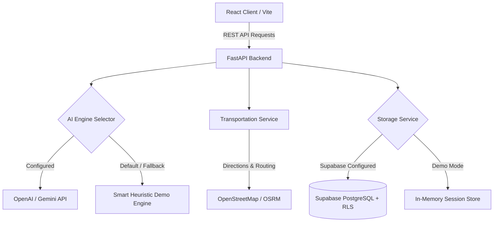

# TravelWise AI — Personalized Travel Itinerary Planner

> **Academic Project in Transportation Domain**  
> An intelligent full-stack travel planning platform built with **FastAPI**, **React (Vite)**, **Tailwind CSS**, **Supabase**, and **Generative AI** for multimodal transit optimization and day-by-day travel itinerary generation.

---

## 1. Project Overview

**TravelWise AI** is a personalized itinerary planner that creates structured, practical, day-by-day travel schedules based on user-defined destinations, budgets, travel styles, and daily activity pacing. It synthesizes inter-attraction routes (walking, metro, rideshare, driving), calculates real-time budget breakdowns, and allows surgical day-by-day regeneration and trip management.

---

## 2. Problem Statement

Modern travelers face decision fatigue, fragmented logistics, and unrealistic schedules when planning trips:
- Activities are often planned without consideration of geographic proximity, leading to excessive transit times.
- Budget estimates frequently overlook transit, taxes, and meals, causing financial surprises.
- Static travel itineraries cannot be customized or updated on a per-day basis without redoing the entire vacation schedule.
- Existing planners rarely optimize for multimodal transportation (walking paths vs. subway passes vs. rental vehicles).

---

## 3. Project Objectives

1. **Multimodal Transportation Integration**: Provide realistic walking, metro, and transit suggestions with verified OpenStreetMap routing directions.
2. **Personalized Itineraries**: Cater to Solo travelers, Couples, and Groups with distinct pacing and dining options.
3. **Budget Transparency**: Real-time expense allocation (accommodation, food, transit, sights) with Recharts visual graphs.
4. **Interactive Trip Customization**: Add, delete, reorder, or regenerate single days without overwriting the rest of the trip.
5. **Zero-Friction Demo Mode**: Fully functional out of the box with zero external API keys or paid tiers required.

---

## 4. Key Features

- **Smart Trip Builder**: 5-step wizard capturing destination, dates, budget, travel styles, and accommodation/food/transport preferences.
- **Multimodal Route Synthesis**: Estimates inter-activity durations, walking recommendations, transit fares, and direct OpenStreetMap links.
- **Surgical Single-Day Regeneration**: Refine a single day with custom natural-language instructions while preserving all other days.
- **Live Budget Visualizer**: Visual breakdown and real-time alerts when estimated expenses exceed target limits.
- **Trip Management (CRUD)**: Save, edit, duplicate, and delete trips with confirmation dialogs.
- **Export & Print Ready**: Built-in `@media print` layout and one-click JSON data export.
- **Dual-Mode Architecture**: Seamless transition between local demo storage and live Supabase PostgreSQL / OpenAI / Gemini LLMs.

---

## 5. Technology Stack

### Frontend
- **React 19 & Vite**: Ultra-fast single-page application framework.
- **Tailwind CSS v3**: Clean, modern SaaS travel design system with customized color palette.
- **React Router DOM v7**: Client-side routing and protected paths.
- **Lucide React**: Crisp iconography for transportation, calendar, and sights.
- **Recharts**: Interactive SVG charts for expense allocations.
- **Supabase JS**: Client library for Supabase database and authentication.

### Backend
- **Python 3.10+ / 3.14**: High-performance backend runtime.
- **FastAPI**: Modern, asynchronous web framework with automatic OpenAPI documentation.
- **Uvicorn**: ASGI web server.
- **Pydantic v2**: Strict schema validation for AI responses and request payloads.
- **HTTPX**: Asynchronous HTTP client for LLMs and external routing requests.
- **Pytest & Pytest-Asyncio**: Automated backend unit and integration testing.

### Database & Auth
- **Supabase PostgreSQL**: Relational database with Row Level Security (RLS).
- **Supabase Auth**: JWT-based user authentication.
- **Local Fallback**: In-memory repository for zero-dependency demo evaluation.

---

## 6. System Architecture



---

## 7. Folder Structure

```
SmarBridge/
├── frontend/
│   ├── src/
│   │   ├── components/
│   │   │   ├── common/         # Loading, Error, Empty, Confirmation Dialogs
│   │   │   ├── dashboard/      # TripCard, TravelStats
│   │   │   ├── itinerary/      # ItineraryHeader, ActivityCard, TransportationCard, BudgetSummary, BudgetChart
│   │   │   ├── layout/         # Navbar, Footer
│   │   │   └── trip-builder/   # Step sections (Destination, Budget, Style, Preferences, Summary)
│   │   ├── context/            # AuthContext, ToastContext
│   │   ├── pages/              # LandingPage, LoginPage, SignupPage, DashboardPage, CreateTripPage, ItineraryPage, EditTripPage, NotFoundPage
│   │   ├── services/           # api.js, supabase.js
│   │   ├── App.jsx
│   │   ├── index.css
│   │   └── main.jsx
│   ├── public/
│   │   └── logo.svg
│   ├── package.json
│   ├── tailwind.config.js
│   ├── postcss.config.js
│   ├── vite.config.js
│   └── .env.example
├── backend/
│   ├── app/
│   │   ├── api/
│   │   │   └── routes/         # health.py, itinerary.py, trips.py, auth.py
│   │   ├── core/               # config.py
│   │   ├── models/             # trip.py, itinerary.py
│   │   ├── schemas/            # trip.py, itinerary.py
│   │   ├── services/           # ai_service.py, trip_service.py, transportation_service.py, supabase_service.py
│   │   ├── utils/              # errors.py
│   │   └── main.py
│   ├── tests/
│   │   ├── test_health.py
│   │   └── test_itinerary.py
│   ├── requirements.txt
│   └── .env.example
├── supabase/
│   └── schema.sql              # Profiles, Trips, Trip_Notes, Triggers, RLS Policies
├── README.md
└── .gitignore
```

---

## 8. Prerequisites

- **Python**: Version 3.10 or newer (tested on Python 3.14).
- **Node.js**: Version 18.0 or newer (tested on Node.js v24.18.0).
- **Git** / **PowerShell** (Windows).

---

## 9. Installation Instructions

All commands below should be executed from the root `c:\Users\hp\SmartBridge` directory in **Windows PowerShell**.

### 1. Backend Setup

```powershell
# In c:\Users\hp\SmartBridge
python -m venv .venv
.\.venv\Scripts\Activate.ps1
.\.venv\Scripts\pip install -r backend\requirements.txt
```

### 2. Frontend Setup

```powershell
# In c:\Users\hp\SmartBridge\frontend
cd frontend
npm install
cd ..
```

---

## 10. How to Run in Demo Mode (Zero Credentials Required)

The application works 100% out of the box in **Interactive Demo Mode** without configuring any API keys or paid accounts!

### Start the Backend Server (Terminal 1)

```powershell
# From c:\Users\hp\SmartBridge
$env:PYTHONPATH="backend"
.\.venv\Scripts\uvicorn app.main:app --host 127.0.0.1 --port 8000 --reload
```
*Backend will be running at:* `http://127.0.0.1:8000`  
*Interactive Swagger API Docs:* `http://127.0.0.1:8000/api/docs`

### Start the Frontend Dev Server (Terminal 2)

```powershell
# From c:\Users\hp\SmartBridge\frontend
cd frontend
npm run dev
```
*Frontend will be running at:* `http://localhost:5173`

Open your browser to `http://localhost:5173`. You can immediately:
- Explore the landing page.
- Launch the **Smart Trip Builder**.
- Generate rich itineraries for Paris, Tokyo, New York, or any custom destination.
- View multimodal transit routes and OpenStreetMap links.
- Edit activities and regenerate individual days.
- Save and duplicate trips in the local session store.

---

## 11. How to Run with Real Integrations

### Supabase Configuration
1. Create a project at [supabase.com](https://supabase.com).
2. Go to the SQL Editor and run the SQL script located in `supabase/schema.sql`.
3. In `backend/.env`, set:
   ```env
   SUPABASE_URL=https://your-project.supabase.co
   SUPABASE_ANON_KEY=your-anon-key
   SUPABASE_SERVICE_ROLE_KEY=your-service-role-key
   ```
4. In `frontend/.env`, set:
   ```env
   VITE_SUPABASE_URL=https://your-project.supabase.co
   VITE_SUPABASE_ANON_KEY=your-anon-key
   ```

### Generative AI Provider Configuration (OpenAI or Gemini)
In `backend/.env`:
```env
# For OpenAI:
AI_PROVIDER=openai
AI_API_KEY=sk-...
AI_MODEL=gpt-4o-mini

# Or for Google Gemini:
AI_PROVIDER=gemini
AI_API_KEY=AIzaSy...
AI_MODEL=gemini-1.5-flash
```

---

## 12. API Endpoint Documentation

| Method | Endpoint | Description |
|---|---|---|
| `GET` | `/` | API status and root information |
| `GET` | `/api/health` | Backend health, demo mode flag, and service status |
| `POST` | `/api/itinerary/generate` | Generates a structured day-by-day travel plan |
| `POST` | `/api/itinerary/regenerate-day` | Regenerates a single day with optional instructions |
| `POST` | `/api/itinerary/revise` | Revises complete plan with natural language directives |
| `GET` | `/api/trips` | Returns all saved trips for the user |
| `POST` | `/api/trips` | Persists a newly generated trip |
| `GET` | `/api/trips/{trip_id}` | Fetches a single trip by ID |
| `PUT` | `/api/trips/{trip_id}` | Updates an existing trip |
| `DELETE` | `/api/trips/{trip_id}` | Deletes a saved trip |
| `POST` | `/api/trips/{trip_id}/duplicate` | Clones a trip with a copy title |
| `GET` | `/api/auth/status` | Reports whether Supabase Auth or Demo is active |

---

## 13. Testing Instructions

Automated unit and integration tests are provided in `backend/tests/`.

To run all tests from PowerShell:

```powershell
# In c:\Users\hp\SmartBridge
$env:PYTHONPATH="backend"
.\.venv\Scripts\python -m pytest backend/tests -v
```

### Verified Test Cases:
1. `test_root_endpoint`: Verifies API welcome response.
2. `test_health_endpoint`: Asserts health checks and integration availability flags.
3. `test_generate_itinerary_valid`: Tests itinerary generation, multimodal transit presence, and JSON schema compliance.
4. `test_generate_itinerary_invalid_dates`: Asserts `422 Unprocessable Entity` when end date precedes start date.
5. `test_generate_itinerary_invalid_destination`: Asserts `422` when destination is invalid.
6. `test_budget_calculations`: Verifies sum of category breakdowns equals total estimated cost.
7. `test_regenerate_day`: Verifies surgical single-day regeneration preserves other days.
8. `test_trip_crud_endpoints`: Verifies listing, creating, reading, updating, duplicating, and deleting trips.

---

## 14. Common Errors and Troubleshooting

1. **Port Conflict (`8000` or `5173` already in use)**:
   - Change backend port: `uvicorn app.main:app --port 8001`
   - Change frontend port: `npm run dev -- --port 5174`
2. **Execution Policy Error in PowerShell**:
   - Run `Set-ExecutionPolicy -Scope Process -ExecutionPolicy Bypass` before activating `.venv`.
3. **ModuleNotFoundError: No module named 'app'**:
   - Make sure you set `$env:PYTHONPATH="backend"` before running uvicorn or pytest.
4. **Missing AI API Key**:
   - The app automatically uses the smart deterministic generator. No crash or error will occur.

---

## 15. Limitations and Future Improvements

- **Real-Time Transit Delays**: Currently, transportation estimates are heuristic and schedule-based. Integrating live GTFS feeds will allow real-time delay warnings.
- **Offline PWA Support**: Adding Service Workers to cache saved itineraries for offline viewing during flights.
- **Flight & Hotel Booking APIs**: Integration with Amadeus or Skyscanner API for live bookable inventory.

---

## 16. Academic Attribution & Domain

Developed as an academic demonstration of AI-driven optimization in the **Transportation & Urban Mobility Domain**, showing practical applications of FastAPI, React, prompt engineering, and Row Level Security.
